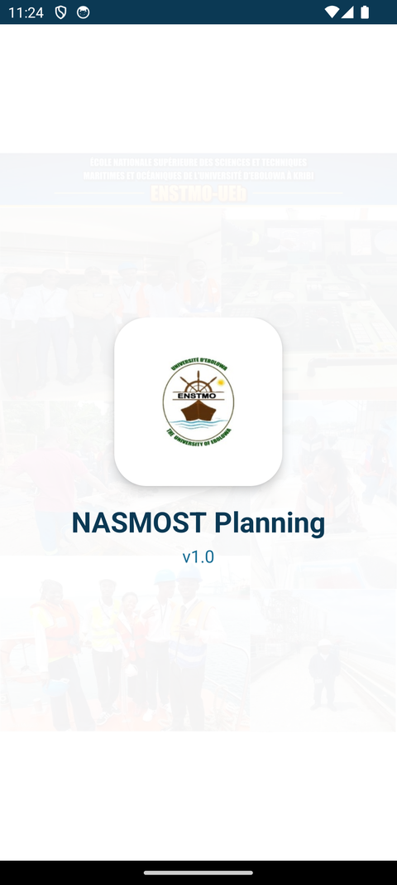
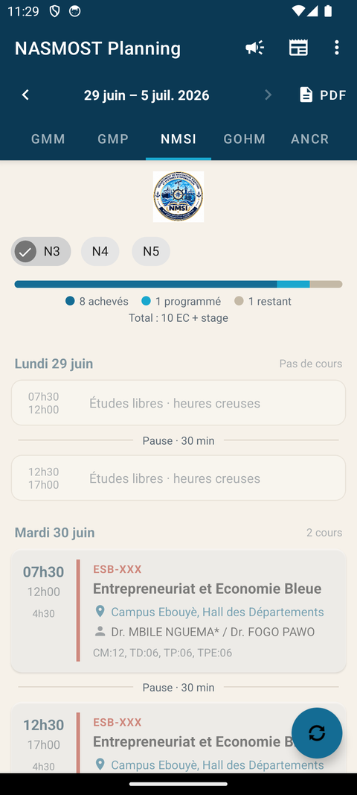
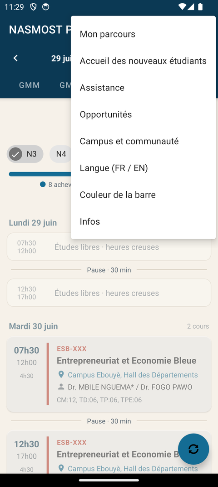
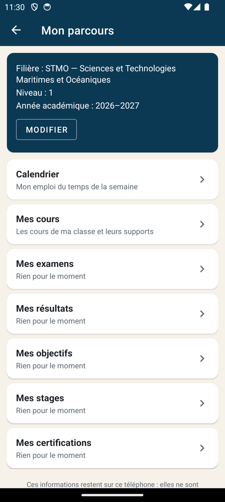
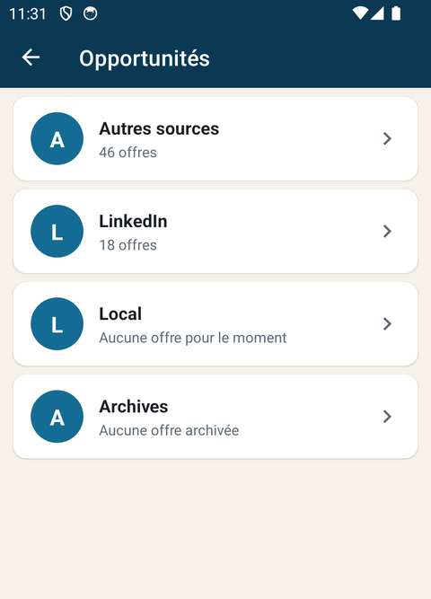

# NASMOST Planning — Guide d'utilisation

Application Android des étudiants de l'ENSTMO (Université d'Ebolowa, Kribi) — version 1.0.

Ce guide a deux parties : **utiliser l'application** (pour tous) et **publier des contenus dans le
dépôt GitHub** (pour les personnes chargées de la mise à jour : emplois du temps, annonces,
supports de cours, opportunités).

- Téléchargement : <https://github.com/f-assene/NASMOST_Planning/releases/latest/download/NASMOSTPlanning.apk>
- Dépôt des contenus : <https://github.com/f-assene/NASMOST_Planning>

---

## 1. L'application en bref

NASMOST Planning affiche l'emploi du temps de chaque département et de chaque niveau, sonne
avant les cours, relaie les annonces de l'école et regroupe ce dont l'étudiant a besoin :
supports de cours, opportunités, informations pratiques et suivi personnel.

Elle n'a **ni compte ni mot de passe**. Tout ce qu'elle affiche vient d'un dépôt GitHub public :
déposer un fichier dans ce dépôt suffit à le faire apparaître sur les téléphones, sans
réinstaller l'application.

<table>
<tr>
<td></td>
<td></td>
<td></td>
</tr>
<tr>
<td align="center">Ouverture</td>
<td align="center">Emploi du temps</td>
<td align="center">Menu ⋮</td>
</tr>
</table>

## 2. Installer et mettre à jour

1. Sur le téléphone Android, ouvrir le lien de téléchargement ci-dessus.
2. Ouvrir le fichier `NASMOSTPlanning.apk` téléchargé. Si Android le demande, autoriser
   l'installation depuis le navigateur.
3. Au premier lancement, **accepter les notifications et les alarmes** : sans elles, pas de
   rappel avant les cours ni d'alerte pour les annonces.

**Mise à jour.** Quand une nouvelle version est publiée, l'application le signale à l'ouverture
(et dans *Infos → Rechercher une mise à jour*). Il suffit alors de télécharger et d'ouvrir le
nouveau fichier : les réglages sont conservés.

## 3. Utiliser l'application

### 3.1 L'emploi du temps

| Élément | À quoi il sert |
|---|---|
| Onglets (STMO, SGMP, GCO…) | Choisir le département. |
| Pastilles N1, N2… | Choisir le niveau. Pour GMP, choisir d'abord la filière : GSE, GOP ou GLP. |
| `‹` semaine `›` | Passer d'une semaine publiée à l'autre, y compris les semaines passées. |
| Bouton **PDF** | Ouvrir l'emploi du temps officiel ; la version signée est proposée en premier. |
| Barre de progression | Avancement des EC de la classe, avec sa légende : achevés, programmés, restants. |
| « n supports de cours » | Un appui sur le cours donne la liste des supports déposés et ouvre le fichier. |
| Bouton rond ⟳ | Actualiser tout de suite. |

L'application se met aussi à jour seule : à l'ouverture, puis toutes les trois heures environ.
Une fois chargé, l'emploi du temps reste consultable **sans connexion**.

**Alarmes.** Une alarme sonne 30 et 15 minutes avant les cours du matin, 15 minutes avant ceux
de l'après-midi, même téléphone verrouillé.

### 3.2 Les icônes de la barre du haut

- **Mégaphone — Annonces** : communiqués de l'école (texte, image, PDF, Word, Excel). Une
  notification sonore signale chaque nouvelle annonce. L'icône de filtre permet de choisir son
  département pour ne voir que ce qui le concerne.
- **Journal — Actualités** : actualités maritimes, portuaires et océanographiques, en français et
  en anglais, d'abord le golfe de Guinée, puis l'Afrique, puis le monde.

### 3.3 Le menu ⋮

<table>
<tr>
<td></td>
<td></td>
</tr>
<tr>
<td align="center">Mon parcours</td>
<td align="center">Opportunités</td>
</tr>
</table>

| Entrée | Contenu |
|---|---|
| **Mon parcours** | Profil (département, filière, niveau, année académique), calendrier, cours de sa classe, et ses examens, résultats, objectifs, stages et certifications. Tout est saisi par l'étudiant et **reste sur son téléphone**. Une fois le profil rempli, l'application s'ouvre sur son département. |
| **Accueil des nouveaux étudiants** | Fonctionnement de l'école, filières, contacts, démarches. |
| **Assistance** | Questions fréquentes et renseignements. |
| **Opportunités** | Stages, emplois, bourses, formations, classés par libellés : *Local* (associations, clubs), *LinkedIn* et *Autres sources* (récupérés automatiquement selon les filières de l'école), *Archives* (offres dont la date est passée). |
| **Campus et communauté** | Associations, événements, conférences. |
| **Langue (FR / EN)** | Français ou anglais. Les contenus publiés par l'école restent dans leur langue d'origine. |
| **Couleur de la barre** | Bleu marine, noir, magenta, rose, vert océan, bordeaux ou violet. |
| **Infos** | Objectif de l'application, concepteur, contributeurs, source des données, licence, version. |

---

## 4. Publier des contenus dans le dépôt

Cette partie s'adresse aux personnes qui alimentent l'application.

### 4.1 Avant de commencer

- Il faut un **compte GitHub** ajouté comme collaborateur du dépôt
  [`f-assene/NASMOST_Planning`](https://github.com/f-assene/NASMOST_Planning). Demander l'accès
  à l'administrateur (adresse à la fin de ce guide).
- ⚠️ Le dépôt est **public** : tout fichier déposé est lisible par tout le monde. Ne rien y
  mettre de confidentiel (notes, données personnelles, documents internes).
- Chaque dossier contient un fichier `README.md` qui rappelle quoi y déposer.

### 4.2 Déposer un fichier depuis le site github.com

1. Ouvrir le dépôt, puis **le dossier voulu** (par exemple `NMSI`).
2. Cliquer **Add file → Upload files**.
3. Glisser le ou les fichiers dans la page.
4. En bas, cliquer **Commit changes**.

Pour écrire un petit fichier texte (une annonce, par exemple) : **Add file → Create new file**,
saisir le nom (`2026-10-20_Reunion.txt`) et le contenu, puis **Commit changes**.

Pour **corriger** un fichier, redéposer un fichier du même nom. Pour **retirer** un contenu,
ouvrir le fichier, menu `…` → **Delete file** → **Commit changes**.

### 4.3 Délai avant l'affichage

Après chaque dépôt, l'action GitHub **« Publication »** convertit les emplois du temps et met à
jour la liste des fichiers. Compter **1 à 2 minutes**, puis jusqu'à **5 minutes** de délai de
GitHub. Sur le téléphone, appuyer sur ⟳ (ou tirer la liste vers le bas) pour actualiser.

### 4.4 Quoi déposer, et où

| Contenu | Dossier | Nom du fichier |
|---|---|---|
| Emploi du temps | `<DÉPARTEMENT>/` (ex. `NMSI/`) | `EDT_NMSI_3_05_10_10_10_2026.pdf` |
| Version signée (scannée) | même dossier | `scan_` + le même nom |
| Logo d'un département | `logos/` | `NMSI.png` (code du département) |
| Annonce | `announcements/` | `2026-10-20_Titre.txt` (+ pièce jointe de même nom) |
| Support de cours | `supports/<DÉPARTEMENT>/<cours>/` | libre (PDF conseillé) |
| Page d'accueil | `accueil/` | `01_Bienvenue.txt` |
| Assistance | `assistance/` | `01_Qui_contacter.txt` |
| Opportunité | `opportunites/<libellé>/` | `2026-10-20_Titre.txt` |
| Vie du campus | `campus/` | `2026-10-25_Conference.txt` |

Codes des départements : STMO, SGMP, GCO, PEM, GEM, GMM, GMP, NMSI, GOHM, ANCR, SSIP.

### 4.5 Emplois du temps

1. Dans le dossier du département, déposer **l'original** : le PDF *enregistré depuis Word*
   (ou le `.docx`). C'est lui qui sert à construire l'emploi du temps affiché.
2. Après signature, déposer **la version scannée** sous le même nom précédé de `scan_`. C'est
   elle que le bouton **PDF** propose en premier.

```
NMSI/EDT_NMSI_3_05_10_10_10_2026.pdf        original
NMSI/scan_EDT_NMSI_3_05_10_10_10_2026.pdf   version signée
```

- **Nom conseillé** : `EDT_<DÉPARTEMENT>_<NIVEAU>_<JJ>_<MM>_<JJ>_<MM>_<AAAA>.pdf` — jour et mois
  du lundi, jour et mois du dernier jour, année. Sans espaces ni accents.
- La classe et la semaine sont lues d'abord dans **l'en-tête du document** :
  `NIVEAU : NMSI 3` et `Semaine du 05 Octobre au 10 Octobre 2026`.
- **GMP** : écrire la filière dans l'en-tête (`NIVEAU : GSE 3`) ou dans le nom
  (`EDT_GSE_3_…`), et déposer dans `GMP/`.
- **Barre de progression** : elle apparaît si le document contient, sous le tableau, la ligne
  `Nombre d'EC prévus: 10  Nombre d'EC achevés: 06  Nombre d'EC programmés: 02  Nombre d'EC restants: 02`.
- ⚠️ Un **PDF scanné** (photo, CamScanner) ne peut pas servir d'original : son texte n'est pas
  lisible par la conversion. Il doit rester la version `scan_…`, à côté de l'original.
- Ne pas modifier les fichiers `.ics` : ils sont créés automatiquement.

### 4.6 Annonces

Une annonce = un ou deux fichiers **de même nom** dans `announcements/` :

```
2026-10-20_Reunion_delegues.txt     description (obligatoire pour un texte seul)
2026-10-20_Reunion_delegues.pdf     pièce jointe facultative : image, .pdf, .docx ou .xlsx
```

Contenu du fichier `.txt` :

```
Réunion des délégués
La réunion aura lieu mardi 20 octobre à 15h, salle 6.

Départements: NMSI, GCO
Expire: 2026-10-21
```

- **1re ligne** : le titre. **Lignes suivantes** : le texte.
- `Départements:` (facultatif) : `TOUS`, ou les codes concernés séparés par des virgules.
- `Expire:` (facultatif) : date `AAAA-MM-JJ` après laquelle l'annonce disparaît.
- Commencer le nom par la date `AAAA-MM-JJ_` : les plus récentes s'affichent en haut.
- Chaque nouvelle annonce déclenche **une** notification sur les téléphones.

### 4.7 Supports de cours

```
supports/NMSI/NSI-3231/Chapitre 1.pdf
supports/STMO/Chimie pour ingénieurs/TD/Série 1.docx
```

Le dossier du cours porte le **code de l'EC** ou l'**intitulé du cours**, tels qu'ils figurent
dans l'emploi du temps (majuscules, accents et espaces sans importance). Le cours affiche alors
« n supports de cours » dans l'application.

### 4.8 Accueil, assistance, campus

Mêmes règles que les annonces (fichier `.txt` + pièce jointe facultative de même nom).

- `accueil/` et `assistance/` : pages classées par nom de fichier — commencer par `01_`, `02_`…
- `campus/` : commencer par la date `AAAA-MM-JJ_`.
- Les adresses web, e-mails et numéros de téléphone écrits dans le texte sont cliquables.

### 4.9 Opportunités

Chaque **sous-dossier** de `opportunites/` est un libellé affiché dans l'application.

```
opportunites/Local/2026-10-20_Formation_Python.txt     une offre déposée à la main
opportunites/Local/logo.png                            logo du libellé (facultatif)
opportunites/LinkedIn/flux.txt                         recherches automatiques
```

- **Déposer une offre** : comme une annonce, dans le dossier du libellé. Indiquer la date limite
  avec `Expire: AAAA-MM-JJ` : passé cette date, l'offre va d'elle-même dans **Archives**.
- **Créer un libellé** : créer un sous-dossier (le signe `_` s'affiche comme un espace).
- **Logo d'un libellé** : déposer `logo.png` dans son dossier ; sinon son initiale est affichée.
- **Offres automatiques** : le fichier `flux.txt` contient des adresses de flux RSS et trois
  listes de tri — `Mots-clés:`, `Offres:`, `Exclure:`. Pour écarter un sujet hors propos,
  ajouter un mot à la ligne `Exclure:`. Le tri étant automatique, il reste imparfait.

### 4.10 Vérifier que tout s'est bien passé

- Onglet **Actions** du dépôt : une coche verte indique que la publication a réussi.
- Fichier **`RAPPORT_CONVERSION.md`** à la racine : il liste les emplois du temps qui n'ont pas
  pu être lus, et pourquoi. Une erreur sur un fichier n'empêche jamais la publication des autres.
- Dans l'application : actualiser, puis vérifier l'onglet du département.

---

## 5. Problèmes fréquents

| Problème | Solution |
|---|---|
| L'emploi du temps déposé n'apparaît pas | Attendre 5 à 10 minutes puis actualiser. Lire `RAPPORT_CONVERSION.md`. |
| « PDF scanné : le texte ne peut pas être lu » | Déposer l'original (PDF enregistré depuis Word, ou `.docx`) et renommer le scan en `scan_…`. |
| Le niveau ou la semaine est introuvable | Vérifier l'en-tête du document : `NIVEAU : NMSI 3`, `Semaine du … au …`. |
| Le logo ne s'affiche pas | Le fichier doit porter exactement le code du département : `logos/ANCR.png`. |
| Un support de cours n'apparaît pas | Le nom du dossier doit être le code de l'EC ou l'intitulé exact du cours. |
| Pas d'alarme avant les cours | Autoriser les notifications et les alarmes dans les réglages Android de l'application. |
| « Erreur de synchronisation » | Vérifier la connexion ; les données déjà chargées restent consultables. |
| Une annonce est visible par les mauvais départements | Corriger la ligne `Départements:` du fichier `.txt`. |

## 6. Contact

Conception et développement : **Fernand ASSENE** — <fernandassene@hotmail.com>

Contributeurs : SIMO DJIENOUASSI F., TAGNE TCHUMMAMO G. F. et ESSINDI Pierre B., élèves
ingénieurs en Navigation Maritime (Promo 001).

Une idée d'amélioration ? Écrire à l'adresse ci-dessus.
